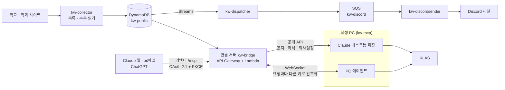

<div align="center">


# kw-campus

**KW CAMPUS (광운 캠퍼스)의 서버: 학교 공지 수집, 공개 API, 웹·폰 연결, Discord 알림**

광운대 학교 홈페이지와 학과·단과대 게시판의 공지를 AWS 서울 리전에서 모아 Discord 채널로 알리고, Claude 데스크톱 확장에 공지·학식·학사일정을 내려 줍니다.<br>
연결 서버(bridge)는 Claude 웹·모바일과 ChatGPT의 커넥터 질문을 학생 PC로 전달하고, 학번·비밀번호와 KLAS 데이터는 저장하지 않습니다.

[](https://github.com/kyowon1108/kw-campus/actions/workflows/ci.yml)

광운대학교 공식 서비스가 아닙니다 · 학생 PC 쪽 확장과 에이전트는 [kw-mcp](https://github.com/kyowon1108/kw-mcp)

</div>

## 하는 일

1. 수집기가 평일 09:00~18:40에 20분마다, 그리고 21:00에 학교 홈페이지와 학과·단과대·부서 게시판의 첫 페이지를 읽습니다. 같은 서버에는 60초 이상 간격을 두고, 서버마다 하루 상한을 넘기지 않습니다.
2. 새 공지는 본문 없이 제목·분류·부서·날짜·링크를 저장하고, 저장하기 전에 제목 속 연락처·학번·사람 이름을 가립니다. 그다음 본문·첨부·포스터를 한 번 더 읽어 마감·대상·신청 방법만 뽑아 둡니다.
3. Discord 채널(학교-공지, 학사, 장학, 취업, 학과-공지, 국제)에 올립니다. 학생은 #알림-설정의 버튼으로 원하는 주제의 역할만 켜고, 학교 전체 공지 중 휴강·정전·출입 통제 같은 제목은 `긴급 알림` 역할도 부릅니다. 마감이 있는 공지에는 D-3, D-1에 답글이 달립니다.
4. 학생은 #설치-안내에서 '설치하기'를 눌러 초대 코드를 받고, [설치 안내 페이지](https://l9doaodgw6.execute-api.ap-northeast-2.amazonaws.com/start)에서 Claude 데스크톱 확장(`kw-campus.mcpb`)을 받습니다.
5. 확장은 이 서버의 공개 API에서 공지·학식·학사일정을 받아, 학생 PC에서 KLAS 데이터와 합칩니다. 학생이 웹·폰 연결을 켜면, 연결 서버가 커넥터 질문을 그 PC의 에이전트로 보내고 암호화된 답을 돌려줍니다.

## 어떻게 동작하나



KLAS에 로그인하는 곳은 학생 PC뿐입니다. 서버가 KLAS에 직접 로그인하는 경로는 없습니다.

| 시각 (KST) | 작업 |
| --- | --- |
| 평일 07:30 | 학식과 학사일정 갱신 (`kw-campus`) |
| 평일 08:30 | 마감 D-3·D-1 답글 |
| 평일 08:40 | #운영 채널에 어제 점검 한 줄 (`kw-opsdigest`) |
| 평일 09:00~18:40, 20분마다 + 21:00 | 공지 목록 수집 (`kw-collector`) |
| 평일 09:10~18:50, 20분마다 | 새 공지의 본문·첨부·포스터 읽기 |
| 매일 22:00~23:40, 20분마다 | 덜 읽은 예전 공지 다시 읽기 |
| 월요일 09:00 | 학칙·학사안내 페이지 변경 감시 (`kw-rulewatch`) |

| 주소 | 내용 |
| --- | --- |
| `/start` | 설치 안내. 초대 코드는 주소의 `#` 뒤에 있어 서버로 오지 않습니다 |
| `/privacy` | [개인정보 처리방침](https://l9doaodgw6.execute-api.ap-northeast-2.amazonaws.com/privacy). 보유 기간은 코드의 상수에서 읽어 씁니다 |
| `/mcp` | 웹·폰 커넥터 (Claude·ChatGPT) |
| `/connect` | 웹·폰 연결 페이지. 확장이 받은 1회용 연결 코드로 커넥터 승인을 이어 줍니다 |
| `/dist/...` | 서명된 확장(`.mcpb`), 에이전트 wheel, `latest.json`, 학사 안내 데이터 |
| `/c/<토큰>/api/...` | 확장이 쓰는 공개 JSON API |

연결 서버의 승인·남용 방어와 공개 MCP는 [docs/bridge.md](docs/bridge.md), 게시판 목록과 수집 규칙은 [docs/collectors.md](docs/collectors.md)에 있습니다.

## 학교 서버 예절

- 실행 한 번에 서버마다 요청은 한 번입니다. 학교 홈페이지만 취업게시판·FAQ와 학식·학사일정 때문에 61초 뒤 한 번 더 요청합니다.
- 서버(IP)마다 하루 상한을 둡니다. 학교 홈페이지 44회, 학과 게시판 서버 32회, 학과 블로그 피드 7회입니다.
- 403·429·보안문자 화면을 받으면 30분부터 두 배씩 최대 24시간 쉬고, 3번 연속이면 사람이 다시 켤 때까지 그 서버에 요청하지 않습니다.
- 수집하는 호스트마다 robots.txt를 확인해 [`politeness.py`](src/kwcampus/politeness.py)에 적었고, 막힌 경로와 기록이 없는 호스트는 요청하지 않습니다.
- User-Agent에 처리방침 주소를 적어, 사이트 관리자가 무엇을 하는 프로젝트인지와 수집 거부 방법을 찾을 수 있게 했습니다.

## 개인정보

서버에 저장하지 않는 것

- 학번, 비밀번호, KLAS에서 읽은 내용. PC가 요청마다 다른 키로 암호화해 올린 답은 전달하면 바로, 늦어도 2분 안에 지웁니다. 풀어낸 답은 서버 메모리에만 두고 DB나 디스크에 쓰지 않습니다.
- 공지 본문과 첨부. 뽑은 마감·대상·신청 방법과 본문의 해시만 남깁니다.
- 초대 코드 자체. 해시만 저장합니다.
- 누가 어떤 알림 역할을 켰는지. 이 정보는 Discord의 역할 정보에만 있습니다.
- 서버 로그의 IP 주소, 초대 토큰이 든 요청 주소, 학번·이름·성적.

서버에 남는 것

- 연결 서버(`kw-bridge`): 기기 공개키, OAuth 클라이언트, 코드·토큰의 해시, 연결 ID, 2분짜리 암호문.
- 초대: 한 사람당 3개를 세려고 Discord 사용자 ID, 코드의 해시, 받은 시각.
- 공지(`kw-public`): 가린 제목, 분류, 부서, 날짜, 링크, 뽑은 내용. 마지막으로 바뀐 날부터 120일 뒤 자동으로 지웁니다.
- 이름이 들어갈 수 있는 제목(명단·수상·합격·부고 등)은 Discord에 제목 없이 링크만 올립니다.

공지 요약은 OpenAI API(일부는 Anthropic Claude API)로 만들고, 보내기 전에 본문과 첨부 글의 연락처·학번·사람 이름을 가립니다. 항목별 보유 기간은 [개인정보 처리방침](https://l9doaodgw6.execute-api.ap-northeast-2.amazonaws.com/privacy)에 있습니다.

## 설치와 실행

### 학생

디스코드 #설치-안내에서 초대 코드를 받고 [설치 안내 페이지](https://l9doaodgw6.execute-api.ap-northeast-2.amazonaws.com/start)를 따라 합니다. 확장 쪽 설명은 [kw-mcp README](https://github.com/kyowon1108/kw-mcp#readme)에 있습니다.

### 개발

kw-campus는 [kw-mcp](https://github.com/kyowon1108/kw-mcp)를 경로 의존성(`../kw-mcp`)으로 씁니다. KLAS 로그인 코드와 스냅숏 생성 코드를 PC 에이전트와 같이 쓰기 때문입니다. 두 저장소를 같은 폴더에 나란히 받아야 합니다.

```bash
git clone https://github.com/kyowon1108/kw-mcp
git clone https://github.com/kyowon1108/kw-campus
cd kw-campus
uv sync
uv run pytest -q
./scripts/build_lambda.sh          # build/lambda (arm64, Python 3.13). ../kw-mcp/dist/release(서명된 릴리스)가 있어야 함
cd infra && npm install && ./node_modules/.bin/cdk synth
```

Python 3.13 이상, [uv](https://docs.astral.sh/uv/), CDK를 돌릴 Node.js가 필요합니다. 배포, SSM 스위치와 비밀값, Discord 서버 설정, 초대 관리, 수집기 관리 명령, 알람 대응은 [docs/operations.md](docs/operations.md)에 있습니다.

## 테스트와 CI

```bash
uv run pytest -q
uvx ruff check
```

테스트 1,768개는 moto로 흉내 낸 DynamoDB·SQS·SSM과 저장해 둔 게시판 화면([`tests/fixtures/`](tests/fixtures/))으로 돕니다. 테스트가 네트워크에 접속하려 하면 실패합니다.

[`ci.yml`](.github/workflows/ci.yml)은 push·PR마다 kw-campus와 kw-mcp를 나란히 받아 pytest를 돌리고, `build_lambda.sh` 문법을 확인하고, gitleaks(참고용)를 돌립니다.

## 폴더

| 폴더 | 내용 | 먼저 볼 문서 |
| --- | --- | --- |
| [`src/kwcampus/`](src/kwcampus/) | 수집기, 게시판 파서, 공지 읽기, Discord 전송·버튼, 초대, 운영 점검, 규정 감시 | [공지 수집](docs/collectors.md) |
| [`src/kwcampus/bridge/`](src/kwcampus/bridge/) | 연결 서버: OAuth, 커넥터 MCP, 에이전트 중계, 안내·처리방침 페이지, 내려받기 | [연결 서버와 공개 MCP](docs/bridge.md) |
| [`src/kwcampus/kwnotice/`](src/kwcampus/kwnotice/) | 메인 공지 게시판 파서와 제목 가리기 규칙 | |
| [`infra/`](infra/) | AWS CDK 스택 (DynamoDB, Lambda, API Gateway, SQS, EventBridge Scheduler, 알람) | [운영과 배포](docs/operations.md) |
| [`scripts/`](scripts/) | Lambda 빌드, Discord 서버 설정, 수집기·초대 관리 | [운영과 배포](docs/operations.md) |
| [`tests/`](tests/) | 단위 테스트와 게시판 화면 픽스처 | |
| [`docs/`](docs/) | 연결 서버, 공지 수집, 운영 문서와 화면·디스코드 문구 기준 | [문구 기준](docs/copy-style.md) |

전체 계획은 kw-mcp의 [docs/plan.md](https://github.com/kyowon1108/kw-mcp/blob/main/docs/plan.md)에 있습니다.

## 남은 일

- 배포 권한을 IAM Identity Center의 배포용 역할로 옮겨야 합니다. 순서는 [docs/operations.md](docs/operations.md)의 '배포 권한'에 있습니다.
- API Gateway 요청 제한이 IP별이 아니라서, 누가 한 경로를 계속 두드리면 그 경로를 쓰는 모두가 느려집니다. HTTP API에는 WAF를 붙일 수 없어 경로별 제한과 Lambda 동시 실행 상한으로 막고 있습니다.
- 행복기숙사 공지와 기숙사 식단은 아직 넣지 않았습니다. 식단은 2026-11-06에 빈 목록만 돌아왔습니다.

## 출처와 라이선스

공지는 광운대학교와 학과·단과대·부서, 총동문회, 총학생회, 현장실습 사이트에 공개된 글입니다. 서버에는 가린 제목, 링크, 뽑은 마감·대상·신청 방법만 남기고, 원문의 권리는 각 게시자에게 있습니다.

[MIT 라이선스](LICENSE). PC 쪽 확장과 에이전트는 [kw-mcp](https://github.com/kyowon1108/kw-mcp)에 있습니다.
